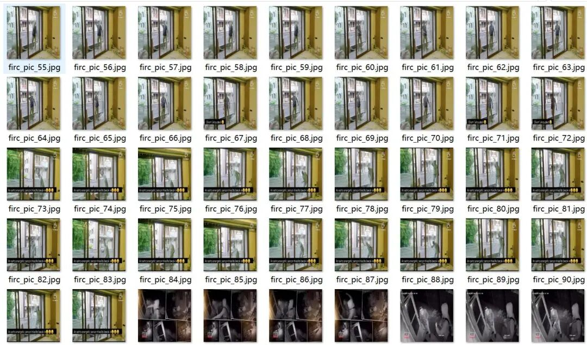
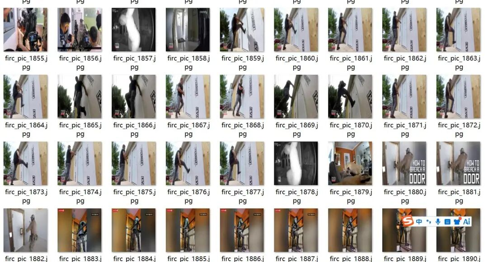
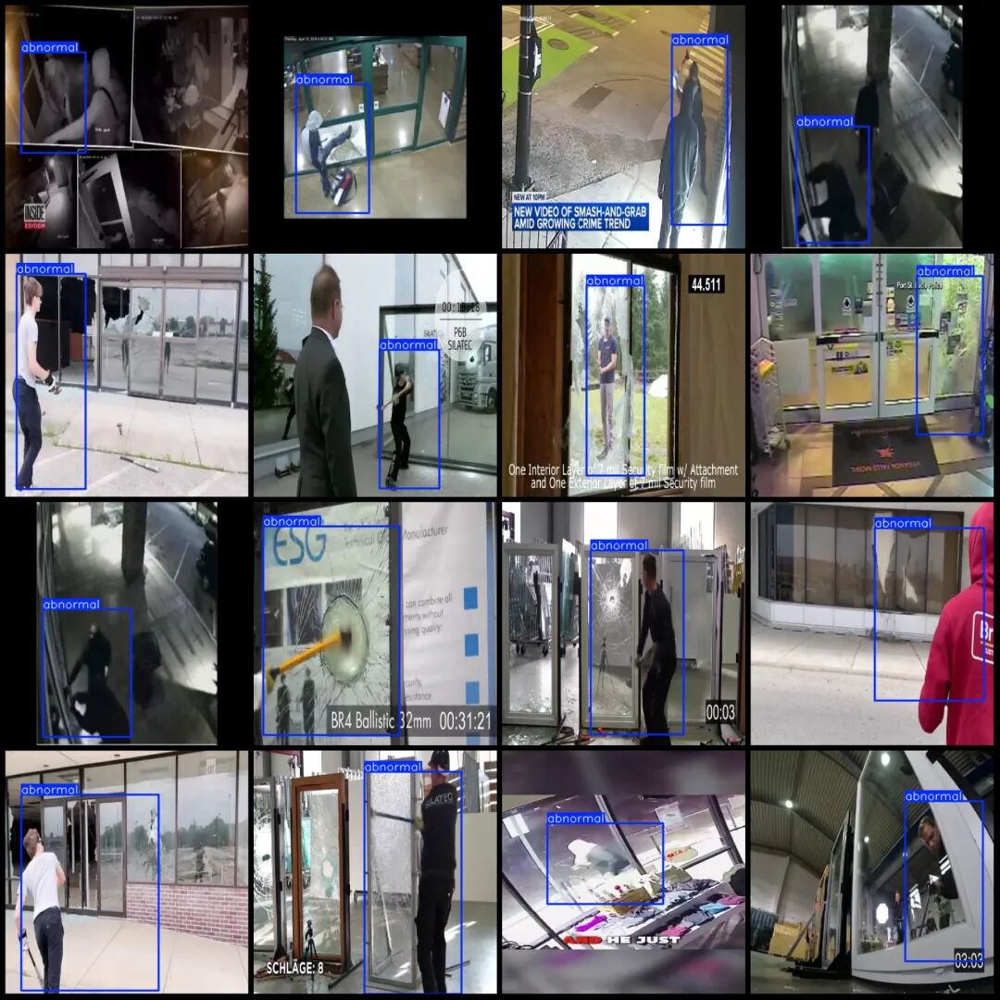
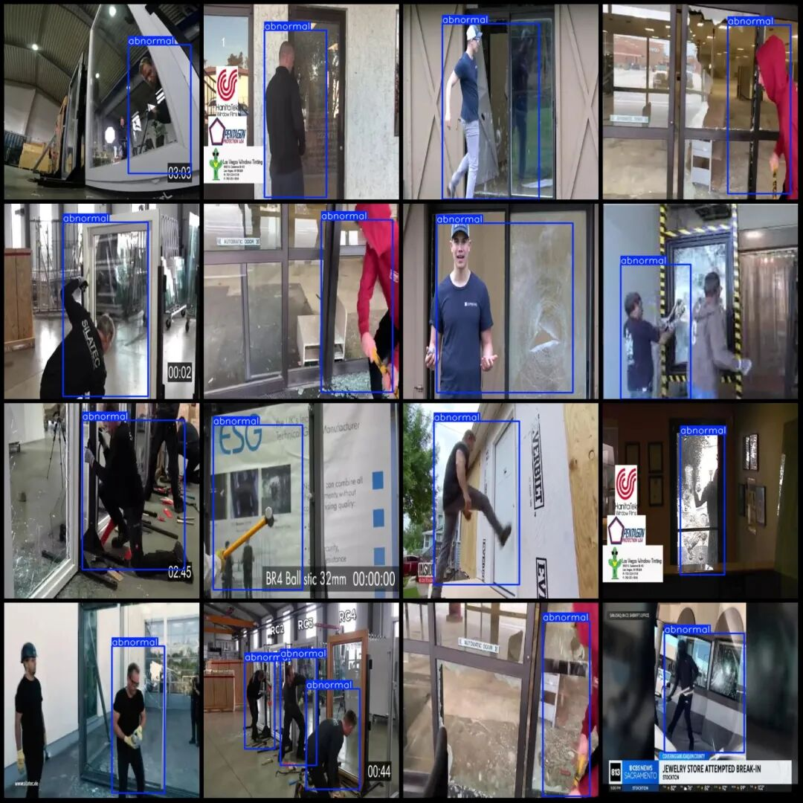

# Store Theft and Burglary Behaviors, Window-Breaking Activities, Product Security Detection Dataset in VOC+YOLO format with 2173 images in 1 category

Please note that the dataset is extracted from multiple videos, with a resolution of 416x416. Please ensure clarity; refunds will not be issued for orders that are unclear or have a resolution too small.

Dataset format: Pascal VOC format + YOLO format (txt file without split path, only containing jpg images and corresponding VOC format xml files and yolo format txt files)

Number of images (number of jpg files): 2173

Number of annotations (number of xml files): 2173

Number of annotations (number of txt files): 2173

Label category count: 1

Label category name: ["abnormal"]

Number of boxes labeled in each category:

Abnormal frame count = 2575

Total frames: 2575

Number of images per category:

Abnormal possession of image count = 2173

Image resolution: 416x416

Using labelImg:

Annotation rules: Draw a rectangle around the category.

Important Notice: The dataset does not have separate training, validation, and test sets; you need to partition them yourself.

Special : This dataset does not guarantee the accuracy of the trained models or weight files.

Image Preview:

Annotation example:

## Payment

Here is a pay link on Stripe ( https://buy.stripe.com/3cs8yP7sY87d0vu9AB ). Please contact me lonlonago@foxmail.com after funding $89, and I will send you a complete data files , thank you!

